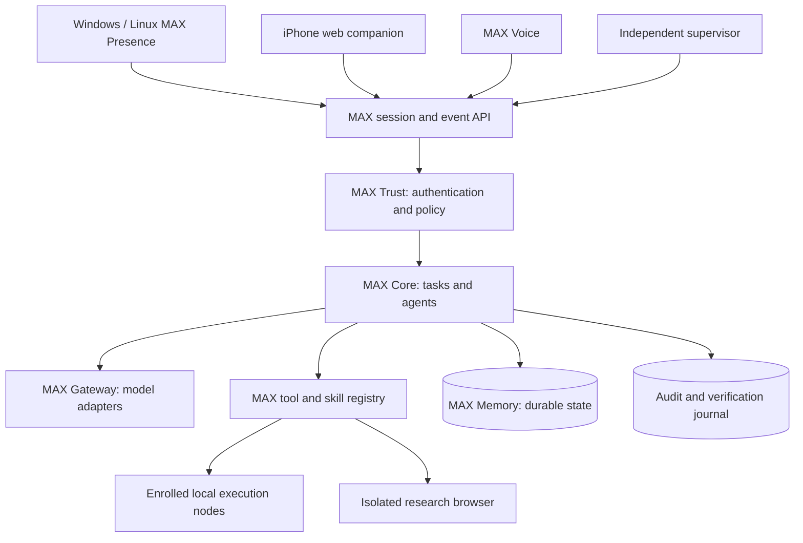

# MAX architecture — Phase 0 baseline

**Status:** Proposed design, not an implemented system.

## Architecture position

MAX is a first-party personal assistant with its own identity, task orchestration, authorization, memory lifecycle, skills governance, and user interface. Third-party software may be integrated behind typed, replaceable boundaries. MAX does not depend on adopting another assistant's runtime as its foundation.

## Logical topology

Modules are logical boundaries; Phase 1 should begin as a modular service with a small number of processes. Split only for isolation, scaling, or operational necessity.

## Authority and data flow

1. An authenticated owner request becomes a scoped task.
2. Core plans with task IDs, deadlines, cancellation and checkpoints.
3. Gateway provides model output as **untrusted proposals**, not authority.
4. Registry validates typed tool arguments; Trust enforces owner/device scope, risk level, and approval.
5. An isolated executor performs only the approved operation.
6. An independent verifier checks observable state before success is recorded.
7. Memory stores an appropriately classified, provenance-tagged summary.

## Key boundaries

- Desktop node never exposes a model-controlled unrestricted shell.
- Skills cannot self-register permissions or change policy.
- A fallback provider cannot bypass a privacy or approval denial.
- External documents, web pages, messages, and tool results cannot become higher-priority instructions.
- Vault, payment, communications, and remote-device actions require dedicated policies.
- Independent process supervision uses finite restart budgets; repair is isolated and reviewed.

## Data

Operational tasks, approvals, and structured memory use a transactional authoritative store. Local caches are disposable. Selected documents and backups use a separate encrypted object/document layer. Deletion, retention, restoration, and access audits must be tested.

## Initial vertical slice

Authenticated session -> persistent task -> one configured model adapter -> one safe read-only tool -> policy decision and audit -> status stream -> verified outcome. No telephony, payments, vault sharing, unrestricted desktop control, or automatic deployment.

See docs/TECHNICAL_DESIGN.md and docs/DECISIONS.md for candidate technologies and unresolved choices.
