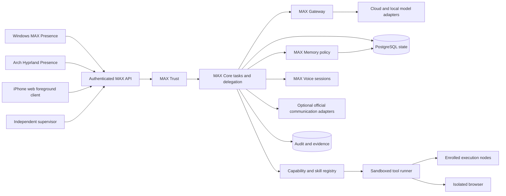
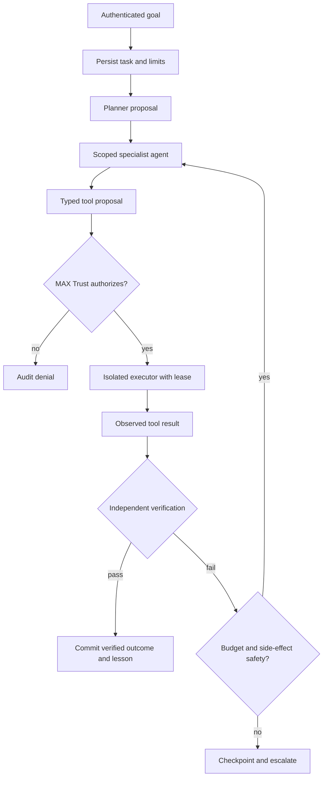
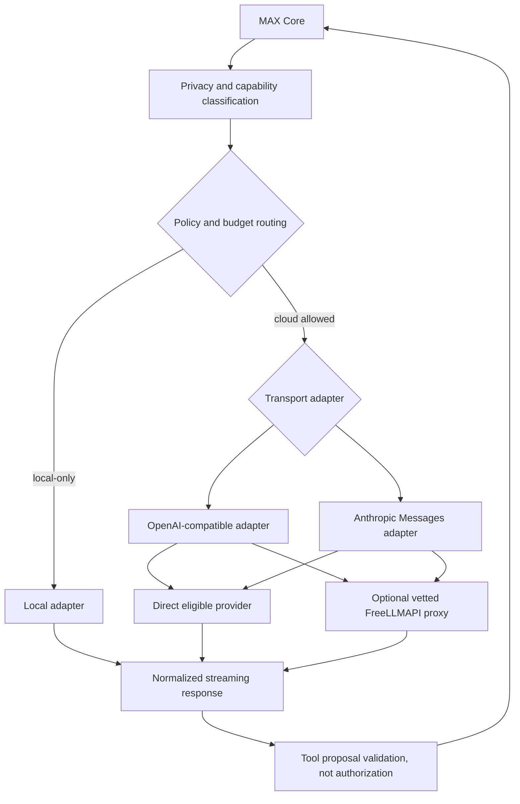
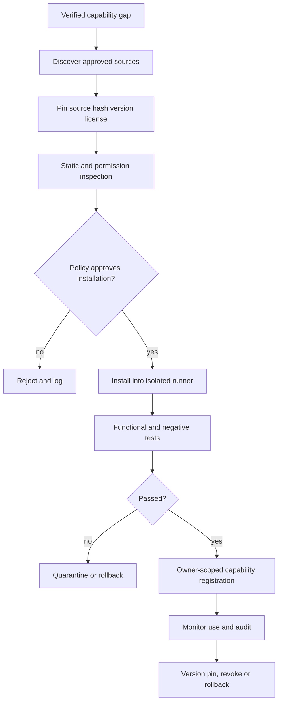
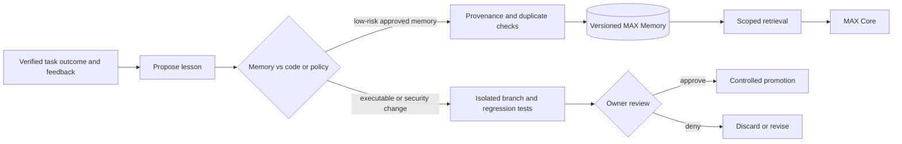
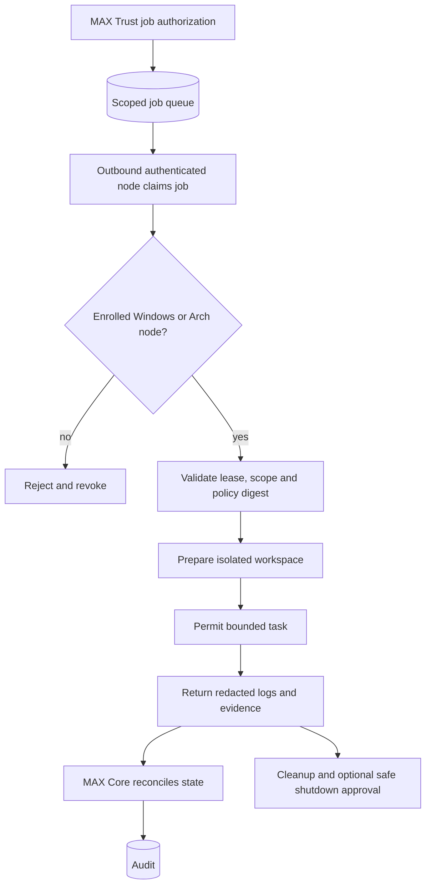
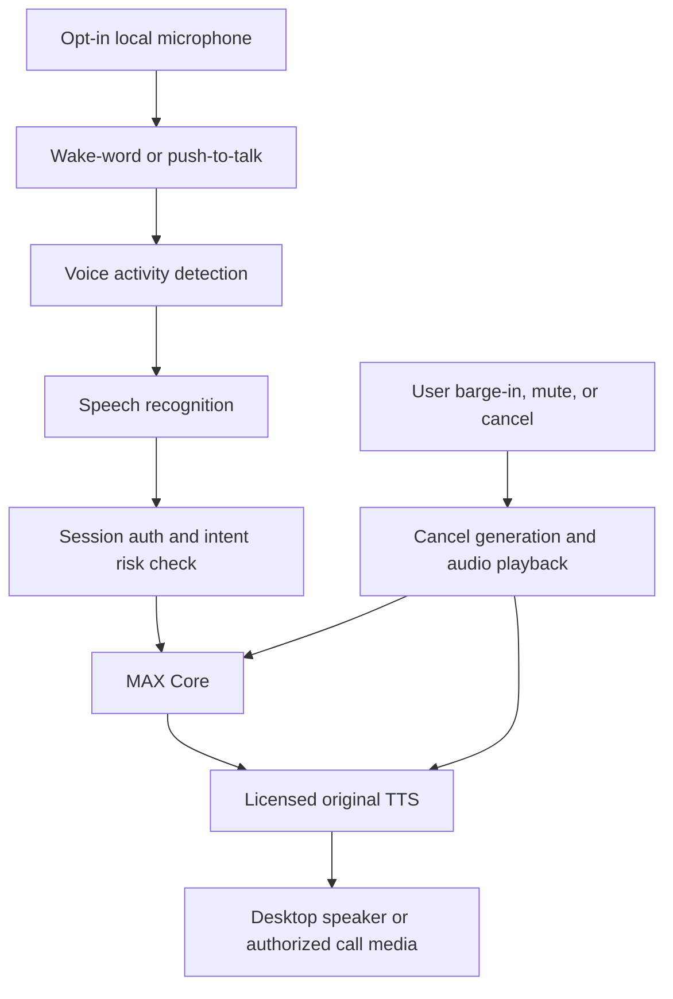
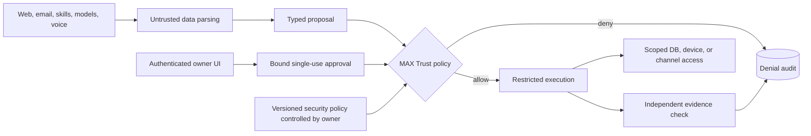

# MAX architecture diagrams — trust boundaries and flows

**Design only.** Arrows describe candidate interfaces, not deployed or proven connections. All sensitive actions pass trusted MAX Trust; no LLM or acquired skill can grant authority.

## 1 — Overall topology

## 2 — Agent orchestration and verification

## 3 — Model Gateway

## 4 — Skill acquisition lifecycle

## 5 — Memory and Evolution

## 6 — Windows/Linux nodes

## 7 — Voice interaction

## 8 — Security and approval boundary

## Diagram acceptance criteria

Review against [THREAT_MODEL.md](THREAT_MODEL.md), [DATA_AND_STORAGE.md](DATA_AND_STORAGE.md), [MODEL_GATEWAY.md](MODEL_GATEWAY.md), [DEVICE_EXECUTION.md](DEVICE_EXECUTION.md) and [TELEPHONY_ARCHITECTURE.md](TELEPHONY_ARCHITECTURE.md). Render every Mermaid graph and test negative cases at each approval, provider, and execution boundary during implementation. Rendering and runtime integration are **not verified by these diagrams alone**.
